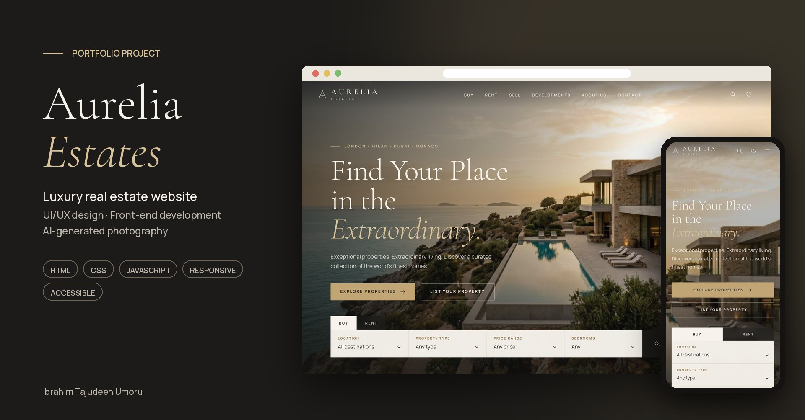

# Aurelia Estates



**Live site:** https://deendev.github.io/aurelia-estates/

A fictional luxury real estate website built as a design and front-end development portfolio project.

## Run it

No build step. Serve the folder with any static server and open `index.html`:

```
npx serve .
# or
python -m http.server 8080
```

## Structure

```
index.html        Semantic page shell, icon sprite, modals and overlays
css/styles.css    Design tokens (colour, type, spacing) and all components
js/data.js        Sample listings, locations, developments, testimonials, offices
js/api.js         API layer. Every call resolves locally today; swap in fetch() for a backend
js/app.js         Router, filters, cards, favourites, gallery, lightbox, forms, validation
img/              Property, interior and destination photography (AI-generated with fal.ai)
```

## Features

- Hash routing: `#home`, section anchors, and `#property-<id>` detail pages
- Buy and rent modes, search by location, type, price range and bedrooms, type chips, sorting
- Quick search overlay (name, city or feature)
- Favourites with a header counter and drawer, kept in localStorage
- Property detail: gallery with thumbnails, keyboard and swipe navigation, full-screen lightbox,
  key facts, features, location card, enquiry form, viewing scheduler, similar properties
- Validated forms: contact, enquiry, viewing, valuation (Sell), development interest, newsletter
- Responsive from 360 px phones to wide desktops, mobile menu, reduced-motion support
- Accessibility: skip link, landmarks, focus trapping in dialogs, aria-live form errors

## Backend integration

See the header comment in `js/api.js` for the suggested endpoints. Forms currently show a
success state with a reference number and a note that nothing was sent.
